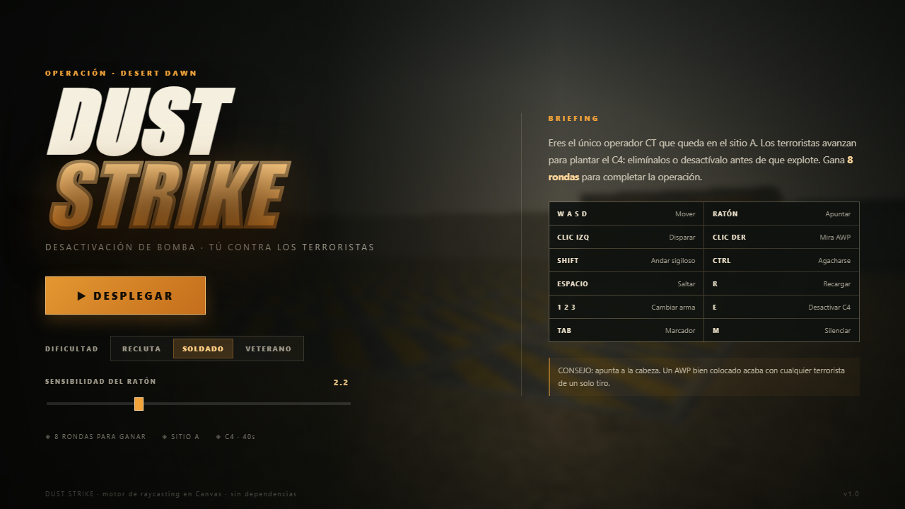
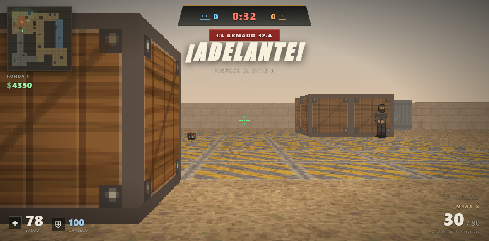

# 🎯 DUST STRIKE — Counter-Strike en el Navegador

> **Juego de disparos táctico 3D en primera persona inspirado en Counter-Strike (Dust II - Sitio A), desarrollado en JavaScript puro (Vanilla JS) y HTML5 Canvas, sin motores externos ni dependencias.**

[](https://fabrizioperezperalta.github.io/KILL_GO/)
[](#)
[](#)
[](#)

---

## 🌐 Enlace de Despliegue (Demo en Vivo)

🎮 **Juega directamente en tu navegador:**  
👉 **[https://fabrizioperezperalta.github.io/KILL_GO/](https://fabrizioperezperalta.github.io/KILL_GO/)**

---

## 📸 Capturas de Pantalla

| Menú Principal y Selección de Dificultad | Acción en Combate (Sitio A) |
|:---:|:---:|
|  |  |

---

## ⚡ Modos de Juego y Características

- **Identificación Obligatoria de Operador:**
  - Registro de nombre de usuario/callsign (2 a 14 caracteres) con persistencia local.
  - Visible en el HUD, el marcador, el killfeed y flotando sobre los personajes en multijugador.

- **Modo Solitario (Singleplayer vs Bots):**
  - Campaña individual contra bots inteligentes con selección de dificultad (*Recluta, Soldado, Veterano*).
  - Tácticas completas de desactivación del C4.

- **Modo Multijugador (Multiplayer 5 vs 5 P2P WebRTC):**
  - **Salas privadas sin saturación:** Cada sala admite un límite balanceado de hasta **5 Antiterroristas (CT)** y **5 Terroristas (T)** (máximo 10 jugadores).
  - **Generación y copiado de enlaces:** Al crear una sala se genera un código único (ej: `DUST-A7X2`) y un enlace directo con un botón para copiar al portapapeles. Tus amigos pueden unirse directamente abriendo el link.
  - **Elección de Bando:** Los jugadores eligen libremente ser **Policía (Antiterrorista)** o **Terrorista**, con control automático de cupo máximo (5 por equipo).
  - **Relleno automático con Bots:** El anfitrión puede activar el completado de huecos con bots tácticos para partidas siempre completas de 5 vs 5.
  - **Modelos y nombres en 3D:** Modelos visuales diferenciados (uniformes tácticos navales con casco y visor para CT, camuflaje y pasamontañas para T) con nombres sobre las cabezas.
  - **Arquitectura P2P sin servidores externos:** Funciona de forma totalmente gratuita y serverless mediante canales de datos WebRTC con PeerJS, 100% compatible con **GitHub Pages**.

- **Motor de Renderizado Raycasting 3D:**
  - Implementación con DDA (Digital Differential Analyzer) para paredes.
  - Floor casting y cielo degradado dinámico.
  - Modelos 2.5D para terroristas, policías, cadáveres, C4 y armas en primera persona con animaciones de balanceo (*bobbing*), retroceso (*recoil*), recarga e impacto.
  - Sistema de partículas para sangre, chispas de impacto, humo y explosión del C4.
  - Mira telescópica con zoom óptico para el rifle francotirador **AWP**.

- **Audio 3D Procedural (Web Audio API):**
  - Efectos de sonido generados por síntesis matemática en tiempo real (disparos para cada tipo de arma, pasos, recargas, beeps del C4 con frecuencia ascendente, explosión masiva y pitido de impacto).
  - Paneo estereofónico 3D según la posición angular respecto a la cámara.

- **Economía y Armería (Buy Menu):**
  - Fase de compra táctica con temporizador al inicio de cada ronda.
  - Armas secundarias: **Glock-18** (pistola inicial T), **USP-S** (pistola inicial CT), **Desert Eagle**.
  - Armas primarias: **AK-47** (rifle de asalto de alta potencia T · 38 daño), **MP5-SD**, **M4A1-S**, **AWP**.
  - Equipo táctico: **Chaleco Kevlar** (absorción de daño) y **Kit de Desactivación** (reduce tiempo de desactivación de 10s a 5s).
  - Jugabilidad C4 completa para ambos bandos: los terroristas pueden portar y plantar el C4 en el sitio A (`[E]`), y los antiterroristas pueden desactivarlo (`[E]`).
  - Marcador táctico 5 vs 5 (`TAB`) con roster simultáneo para ambos bandos, seguimiento de bajas, muertes, headshots y estado en vivo o caído.
  - Control de volumen maestro y efecto acústico de zumbido (tinnitus) tras la detonación del C4.

---

## 🎮 Controles del Juego

| Tecla / Acción | Función |
|:---|:---|
| **W, A, S, D** | Moverse (Adelante, Izquierda, Atrás, Derecha) |
| **Ratón** | Mirar / Apuntar (captura de puntero *Pointer Lock*) |
| **Clic Izquierdo** | Disparar / Apuñalar con cuchillo |
| **Clic Derecho** | Activar mira telescópica (Scope en AWP) |
| **Rueda del Ratón** | Ciclar rápidamente entre armas disponibles |
| **1, 2, 3** / **Numpad 1, 2, 3** | Seleccionar arma Primaria / Secundaria / Cuchillo |
| **R** | Recargar arma actual |
| **G** | Soltar arma primaria en el suelo (Drop Weapon) |
| **Y** | Abrir chat táctico multijugador |
| **E (Mantener)** | Desactivar C4 (CT) / Plantar C4 en sitio A (T) |
| **Shift (Mantener)** | Caminar en silencio (pasos sigilosos, mayor precisión) |
| **Ctrl o C** | Agacharse (reduce tamaño y aumenta precisión) |
| **Espacio** | Saltar |
| **Tab (Mantener)** | Ver el Marcador 5 vs 5 de la partida (*Scoreboard*) |
| **Escape** | Pausar / Reanudar partida táctica |
| **M** | Silenciar / Activar sonido |
| **1 al 7 (en Compra)** | Comprar armas o equipamiento rápidamente |
| **Enter** | Iniciar partida / Comenzar ronda / Continuar |

---

## 📁 Estructura del Código

```plaintext
CSGOEPIS/
├── .github/
│   └── workflows/
│       ├── deploy.yml          # CI/CD: validación de código, tests, auditoría y despliegue en Pages
│       ├── release.yml         # Automatización: empaquetado de release zip y changelog en tags
│       ├── tests.yml           # Automatización: Batería de pruebas unitarias en cada push/PR
│       ├── audit.yml           # Automatización: Auditoría de enlaces y assets en cada push/PR
│       └── benchmark.yml       # Automatización: Bot Benchmark & Stress Test periódico y manual
├── js/
│   ├── core/                   # Capa 2 & 4: Motor Central y Máquina de Estados
│   │   ├── EventBus.js         # Bus de eventos Pub/Sub desacoplado
│   │   ├── GameLoop.js         # Bucle determinista a 60 Hz con interpolación α
│   │   ├── GameStateManager.js # FSM para estados de juego (menu, buy, live, roundover, paused)
│   │   └── Engine.js           # Agregador central del motor (window.Engine)
│   ├── hal/                    # Capa 1: Hardware Abstraction Layer (HAL)
│   │   ├── InputManager.js     # Mapeo semántico de acciones, PointerLock y sensibilidad
│   │   └── AudioManager.js     # Gestión de Web Audio API, buses Master/SFX y volumen
│   ├── ecs/                    # Capa 3: Entity-Component-System (ECS)
│   │   ├── EntityManager.js    # Creación, ciclo de vida, etiquetas y consultas de entidades
│   │   └── Components.js       # Componentes de datos (Transform, Velocity, Health, etc.)
│   ├── render/                 # Capa de Renderizado
│   │   ├── Textures.js         # Generación procedural de texturas, mapas y sprites LUT
│   │   └── Renderer.js         # Raycasting 3D, viewmodels con manos y armas, iluminación
│   ├── game/                   # Simulación y Reglas del Juego
│   │   ├── Game.js             # Estado de partida, jugador, armas, economía y sonido
│   │   └── AI.js               # Algoritmo A*, comportamiento táctico de bots, combate y C4
│   ├── network/                # Capa de Red y Multijugador
│   │   ├── peerjs.min.js       # Cliente WebRTC PeerJS
│   │   └── Multiplayer.js      # Sincronización P2P, salas 5v5 y estados remotos
│   └── ui/                     # Interfaz de Usuario y Presentación
│       └── UI.js               # HUD reactivo, radar, tienda, chat y listeners
├── tests/                      # Suite de Pruebas Unitarias Automatizadas
│   ├── eventbus.test.js        # Pruebas del bus de eventos
│   ├── ecs.test.js             # Pruebas del gestor de entidades y componentes
│   ├── fsm.test.js             # Pruebas de la máquina de estados
│   ├── combat.test.js          # Pruebas de balística, blindaje y economía
│   ├── test_env.js             # Entorno headless mock para Canvas y DOM
│   └── run_tests.js            # Ejecutor unificado de pruebas
├── tools/                      # Herramientas de Automatización
│   ├── audit_assets.js         # Auditoría de integridad de enlaces, scripts y assets
│   └── bot_benchmark.js        # Simulador headless de partidas para balance y estrés
├── index.html                  # Estructura del juego y carga modular de capas
├── package.json                # Comandos de automatización (npm test, audit, benchmark)
├── style.css                   # Estilos visuales oscuros, HUD táctico y diseño responsivo
├── .nojekyll                   # Preserva assets en GitHub Pages
├── .gitignore                  # Exclusiones de Git
├── _shot_live.png              # Captura del juego
├── _shot_menu.png              # Captura del menú
└── README.md                   # Documentación completa del proyecto
```

---

## ⚙️ Automatizaciones y Comandos de Calidad

El proyecto incluye scripts automatizados sin dependencias externas pesadas:

```bash
# Ejecutar la suite completa de pruebas unitarias
npm test

# Auditar la integridad de enlaces, scripts y assets
npm run audit

# Ejecutar el simulador de estrés y balance táctico (50 rondas headless)
npm run benchmark

# Ejecutar validación combinada (tests + auditoría)
npm run check
```

### En el navegador:
Puedes ejecutar el benchmark táctico directamente desde la consola de desarrollador del navegador escribiendo:
```javascript
DUST.benchmark(50);
```

### Generación Automática de Releases:
Al publicar un tag de versión en Git (ej. `v1.1.0`), la acción `.github/workflows/release.yml` compilará las notas de versión con el changelog automático y adjuntará un paquete `.zip` standalone offline listo para jugar.

---

## 🚀 Despliegue en GitHub Pages

Este repositorio cuenta con un flujo de trabajo automatizado con **GitHub Actions** en `.github/workflows/deploy.yml`.

### Pasos para activarlo en tu repositorio de GitHub:

1. Ve a tu repositorio en GitHub: [https://github.com/FabrizioPerezPeralta/KILL_GO](https://github.com/FabrizioPerezPeralta/KILL_GO).
2. Haz clic en **Settings** (Configuración) > **Pages** (en el menú lateral izquierdo).
3. En la sección **Build and deployment** > **Source**, selecciona **GitHub Actions**.
4. Cada vez que realices un `git push` a la rama `main`, la acción compilará y publicará el juego automáticamente.

---

## 🛠️ Ejecución Local

Dado que el juego está desarrollado en JavaScript puro y Canvas, no requiere instalación de paquetes de Node. Puedes probarlo con cualquier servidor estático local:

### Con Python:
```bash
python -m http.server 8000
```
Luego abre tu navegador en `http://localhost:8000`.

### Con Node.js (npx serve):
```bash
npx serve .
```

---

## 📄 Licencia

Este proyecto es de código abierto bajo la licencia MIT. Creado por [Fabrizio Perez Peralta](https://github.com/FabrizioPerezPeralta).
